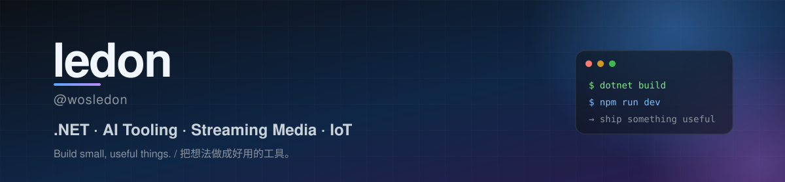

  

  
  

  
  
  
  

## 👋 About Me / 关于我

Hi, I'm **ledon** ([@wosledon](https://github.com/wosledon)) — a developer based in China who likes turning ideas into small, useful tools.

- 🔭 Currently building **[Hetu](https://github.com/wosledon/Hetu)**, a local-first AI knowledge & agent workspace, and **[ledon-framework](https://github.com/wosledon/ledon-framework)**, a modular .NET 10 web framework.
- 🎥 Author of **[Berry.Live](https://github.com/wosledon/Berry.Live)**, a ready-to-use .NET live streaming server with RTMP push and HTTP-FLV / WebSocket-FLV pull.
- 🤖 Exploring AI agents, RAG, MCP and developer tooling.
- 🚗 Experience in streaming media, communication systems and IoT / connected vehicles.
- 🧰 Mostly writing **C# / .NET**; reaching for **TypeScript, Rust and Go** when they fit.
- 💬 Ask me about .NET, live streaming, RAG pipelines, or developer experience.

> 你好，我是 **ledon**，一名来自中国的开发者。喜欢把想法做成真正好用的工具，长期专注于 .NET、AI Agent、流媒体、通信系统与物联网（车联网）。主要使用 **C# / .NET**，也会根据场景选择 **TypeScript、Rust、Go**。

## 🧰 Tech Stack / 技术栈

**Languages** 

**Frameworks & Runtimes** 

**AI & Data** 

**Tools & Infra** 

## 📊 GitHub Stats / GitHub 数据

  
   
  
  

## 🐍 Contribution Snake / 贡献贪吃蛇

  

  <i>“Light!” — stay curious, keep shipping.</i>

  Communities: <a href="https://github.com/maker-community">maker-community</a> · <a href="https://github.com/MineCosmos">MineCosmos</a> · <a href="https://github.com/ShanheMirage">ShanheMirage</a>

